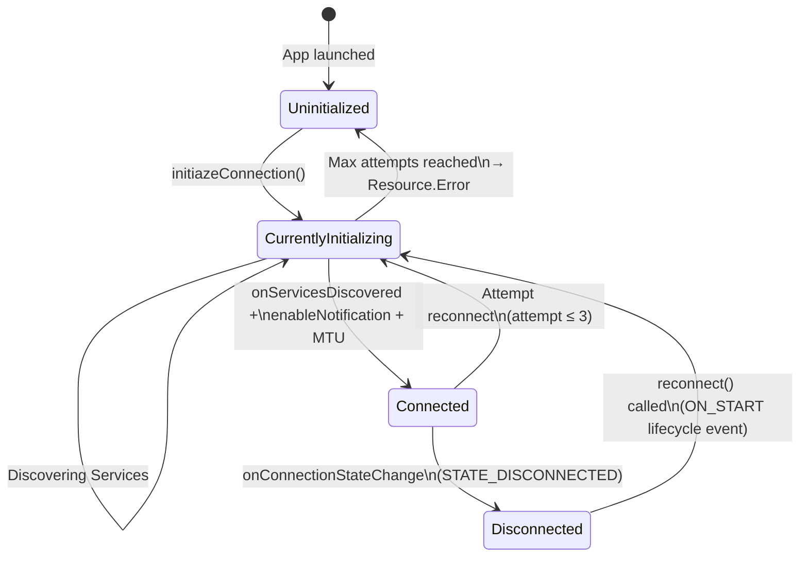

# AI Architecture Analysis

This document contains the instructions for an important task - using AI to define the architecture of this system, so that it can be used by humans and AI agents to more easily understand the system.

## 1. Objective

Map out all of the flows that this application is involved in (use sub agents where necessary to work in parallel). Map how user can navigate through different screens. Also map out the end-to-process from WRITE/READ buttons & textfield to write/read event on the GATT table of the BLE device. Also considering how gradle handles/display new data from BLE to UI and from UI to BLE device. 

Flows should be documented in Mermaid format to allow AI agents to understand, for versioning (in git), and for easy visualization.

## 2. Requirements
1. Print GATT table in .md format and save in /docs
2. BLE Notifications flow from BLE device to RemoteControlScreen.kt
    + Data that uses BoilerTemperatureProgressIndicator.kt
3. Data flow - When User press READ button in RemoteControlScreen.kt
    + How data is readed from  BLE device to GATT and then goes into textfields -> RemoteControlScreen.kt
4. Data flow - When User press WRITE button in RemoteControlScreen.kt
    + How data is parse and its transfer from RemoteControlScreen.kt to the BLE device
4. Data flow - When User press READ button in ControllerParameterScreen.kt
    + How data is readed from BLe device to GATT and then goes into textfields -> ControllerParameterScreen.kt
5. Data flow - When User press WRITE button in ControllerParameterScreen.kt
    + How data is parse and its transfer from ControllerParameterScreen.kt to the BLE device
6. User flow on Navigation.kt
7. User flow on StartScreen.kt
8. Update this file section: ## 4. Architecure; Describe the desing of this system on layers
    + **Output:** [## 4. Architecture](#4-architecure) below — layered MVVM description with data flow diagrams, BLE connection lifecycle, and key design decisions.
9. Generate in docs/architecture a file that describes the desing of this system using to different layout: Layer and other to your choose (tell me which one you decided to use)
    + **Output:** [`docs/architecture/system/system_design.md`](architecture/system_design.md)
    + **Layout 1 — Layer View:** Mermaid `block-beta` diagram showing the four MVVM tiers (Presentation, Domain, Data, DI) and their one-way dependency arrows.
    + **Layout 2 — Component View:** Mermaid `flowchart` diagram showing concrete runtime objects (`RemoteControlBLEReceiveManager`, `RemoteControlViewModel`, Composable screens, `AppModule`, `BluetoothGatt`, BLE device) wired together through SharedFlow channels, Hilt injection, and navigation edges. This layout was chosen because the defining architectural characteristic of this system is reactive data flow through Kotlin SharedFlows — from hardware GATT callbacks all the way to Compose recomposition — which a layered diagram alone cannot capture.

The list of flows should live in ../flows/index.md and each individual flow should be defined in a separate folder.

# Where to find information

- /docs contains ProjectRequirementsDocument.md  describing the design of this system and domain knowledge

## 3. diagram.mermaid Requirements

**CRITICAL RULES:**

1. **File Format**: Must be pure Mermaid syntax with `.mermaid` extension
   - NO markdown headers
   - NO markdown code fences (no ` ```mermaid ` wrapper)
   - Starts directly with `flowchart LR`

2. **Use Swimlane Format**: `flowchart LR` (left-to-right with horizontal swimlanes)
   - Each repository is a horizontal swimlane (subgraph)
   - Flow progresses left to right
   - Swimlane labels should be prominent (use emoji for visibility)
   - Example: `subgraph systemA["🔧 systemA"]`

3. **Systems as Containers**:
   - Each repository MUST be a `subgraph` (horizontal swimlane)
   - Repository name is the subgraph label
   - Operations are nodes inside the subgraph
   - Use `direction LR` inside each subgraph

### Documentation Structure

Each flow must be documented in a separate folder with the following structure:

```
docs/architecture/flows/[flow-name]/
├── README.md              # Each flow is documented in a dedicated folder under(all content in one file)
└── diagram.mermaid        # Mermaid diagram
```

**IMPORTANT**: Use ONLY these two files. Do NOT create separate diagram-notes.md or other files. Keep all documentation consolidated in README.md for easier maintenance.

### README.md Contents

**Use the blueprint as a template**: `docs/architecture/flows/[redacted]/`

### Execution Status

All generated flow files have been updated to comply with these requirements:

| Rule | Applied |
|------|---------|
| File format: pure `.mermaid` extension, no markdown | ✅ Each flow folder contains `diagram.mermaid` |
| Starts directly with `flowchart LR` | ✅ No markdown headers or code fences |
| Swimlane format: `subgraph` per system with emoji label | ✅ All swimlanes use emoji-prefixed labels |
| `direction LR` inside each subgraph | ✅ Applied to every subgraph |
| Flow progresses left to right | ✅ Arrows flow left → right across swimlanes |

**Flow diagram files created:**

| Folder | Diagram file |
|--------|-------------|
| `ble-notifications/` | `diagram.mermaid` |
| `remote-control-read/` | `diagram.mermaid` |
| `remote-control-write/` | `diagram.mermaid` |
| `controller-param-read/` | `diagram.mermaid` |
| `controller-param-write/` | `diagram.mermaid` |
| `navigation/` | `diagram.mermaid` |
| `start-screen/` | `diagram.mermaid` |

**System design diagram files** (in `docs/architecture/system/`):

| File | Diagram |
|------|---------|
| `system_design_layer.mermaid` | Layer View — four MVVM tiers as swimlane subgraphs |
| `system_design_component.mermaid` | Component View — runtime objects, SharedFlows, BLE GATT wiring |


## 4. Architecure 

The BLEspresso app follows **MVVM (Model-View-ViewModel)** with a clean separation across four layers, connected through Kotlin `SharedFlow` streams and Hilt dependency injection.

---

### Layer Overview

```
┌─────────────────────────────────────────────────────────────────┐
│  PRESENTATION LAYER                                             │
│                                                                 │
│  Composable Screens (Jetpack Compose)                           │
│    StartScreen                → Entry point, navigation only    │
│    RemoteControlScreen        → Live temp + machine config I/O  │
│    BlespressoCtrlParamScreen  → PID controller parameter I/O    │
│                                                                 │
│  Jetpack Navigation Compose                                     │
│    NavHost: start_screen → main_screen → ctrl_param_screen      │
│                                                                 │
│  ViewModel (Hilt-injected, shared across screens)               │
│    RemoteControlViewModel     → State holders, BLE orchestration│
│    CTextBox                   → Per-field UI state + validation  │
├─────────────────────────────────────────────────────────────────┤
│  DOMAIN / INTERFACE LAYER                                       │
│                                                                 │
│  RemoteControlReceiveManager (interface)                        │
│    Declares all SharedFlows, read/write functions, signals.     │
│    Decouples ViewModel from BLE implementation.                 │
│    Enables testability (mock implementations).                  │
├─────────────────────────────────────────────────────────────────┤
│  DATA LAYER                                                     │
│                                                                 │
│  RemoteControlBLEReceiveManager (BLE implementation)            │
│    BluetoothAdapter / BluetoothGatt (Android BLE API)           │
│    ScanCallback   → Finds "BLEspresso" by device name           │
│    GattCallback   → Handles connect/disconnect/MTU/read/write/  │
│                     notify callbacks                            │
│    Sequential read queue → GATT-safe multi-characteristic reads │
│    Completion signals: machineConfigReadComplete,               │
│                        pidConfigReadComplete (SharedFlow<Unit>)  │
│                                                                 │
│  Data Models                                                    │
│    BoilerDataResult     → waterTemperature + connectionState    │
│    BoilerSetpoint       → targetTemperature + connectionState   │
│    CharDataClass        → charData (Float) + connectionState    │
│    C_BrewConfigData     → 6 brew phase parameters               │
│    C_PIDConfigData      → 6 PID controller parameters           │
│    ConnectionState      → Uninitialized / CurrentlyInitializing │
│                           / Connected / Disconnected            │
│    Resource<T>          → Success / Loading / Error wrapper     │
├─────────────────────────────────────────────────────────────────┤
│  DEPENDENCY INJECTION                                           │
│                                                                 │
│  Hilt / Dagger — AppModule                                      │
│    Provides: BluetoothAdapter (singleton)                       │
│    Binds: RemoteControlReceiveManager →                         │
│           RemoteControlBLEReceiveManager                        │
└─────────────────────────────────────────────────────────────────┘
```

---

### Data Flow: BLE Device → UI

```
BLE Device
  │  GATT Notification / Read callback
  ▼
RemoteControlBLEReceiveManager.onCharacteristicChanged()
  or  .onCharacteristicRead()
  │  Decode ASCII bytes → Float
  │  Wrap in Resource.Success(DataModel)
  ▼
MutableSharedFlow  (data / dataToRead / dataSteamSetpoint /
                   dataBrewCfg* / dataPIDcfg*)
  │  collect / collectLatest (Coroutine, Dispatchers.Default)
  ▼
RemoteControlViewModel  (mutableStateOf variables)
  │  boilerWaterTemp / boilerSetpointTemp / steamTempSetpoint /
  │  brewConfigData / pIDConfigData / connectionState
  │  Emits _machineConfigLoaded or _pidConfigLoaded when queue drains
  ▼
Composable Screen  (recomposition triggered by mutableStateOf)
  │
  ▼
CTextBox.loadValue()  ←  populates text fields
BoilerTemperatureProgressIndicator  ←  renders live temperature arc
```

### Data Flow: UI → BLE Device

```
User edits CTextBox
  │  onValueChange(): accept digits/decimal, track modified flag
  │  onDone(): clamp to [min, max]
  ▼
User double-taps Write button
  │
  ▼
RemoteControlViewModel.writeMachineConfig() or .writePIDConfig()
  │  Skips null (unmodified) fields
  │  Calls txNewBoilerTargetTemp() / txWritePreInfusionPwr() / etc.
  ▼
RemoteControlBLEReceiveManager.writeCharacteristic()
  │  dataConvertionFloatToCharacteristic(value, sb, digits)
  │  → Fixed-width ASCII string (e.g. 93.5 → "0935")
  │  findCharacteristic(serviceUUID, charUUID)
  │  writeCharacteristicsDevice(char, payload)
  │  WRITE_TYPE_NO_RESPONSE
  ▼
BluetoothGatt.writeCharacteristic()
  ▼
BLE Device GATT Table updated
```

---

### BLE Connection Lifecycle



---

### Key Design Decisions

| Decision | Rationale |
|----------|----------|
| `SharedFlow` instead of `LiveData` | Coroutine-native; supports multiple collectors without lifecycle coupling |
| Sequential GATT read queue | Android BLE GATT is not thread-safe; reads must be serialised to avoid dropped callbacks |
| Completion signals (`machineConfigReadComplete`, `pidConfigReadComplete`) | Replaced `delay(1500L)` hacks with deterministic signals emitted when the read queue drains |
| `CTextBox` class (per-field state) | Encapsulates `userInput`, `modified`, `clickedOnce`, `min/max`, `loadValue()`, `onValueChange()`, `onDone()` in one object |
| Double-tap to Write | Guards against accidental writes to the espresso machine |
| `popUpTo(inclusive=true)` on every navigation | Prevents back-stack accumulation; back button exits rather than cycling through screens |

---

### Flow Documentation

All detailed sequence diagrams and `diagram.mermaid` files live in [`architecture/flows/`](architecture/flows/index.md).

### Flow File Naming Convention

Each flow is documented in a dedicated folder under `docs/architecture/flows/`. Each folder contains exactly two files:

| File | Purpose |
|------|---------|
| `README.md` | Human-readable flow description with sequence diagrams (Markdown) |
| `diagram.mermaid` | Pure Mermaid `flowchart LR` swimlane diagram — no markdown wrapper |

**File layout:**

| Folder | README | Diagram |
|--------|--------|---------|
| `ble-notifications/` | `README.md` | `diagram.mermaid` |
| `remote-control-read/` | `README.md` | `diagram.mermaid` |
| `remote-control-write/` | `README.md` | `diagram.mermaid` |
| `controller-param-read/` | `README.md` | `diagram.mermaid` |
| `controller-param-write/` | `README.md` | `diagram.mermaid` |
| `navigation/` | `README.md` | `diagram.mermaid` |
| `start-screen/` | `README.md` | `diagram.mermaid` |

> **Naming history:** Flow files were initially named `flow.md`, then `flow_<FOLDER_NAME>.md` for grep-ability, then `README.md` for automatic git-platform folder rendering. Diagram files were initially named `<folder-name>.mermaid`, then renamed to `diagram.mermaid` per the Documentation Structure requirement.