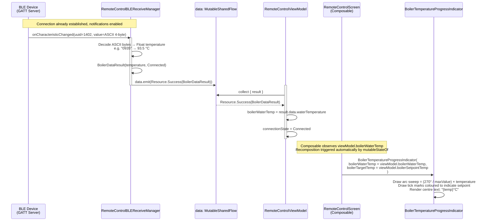
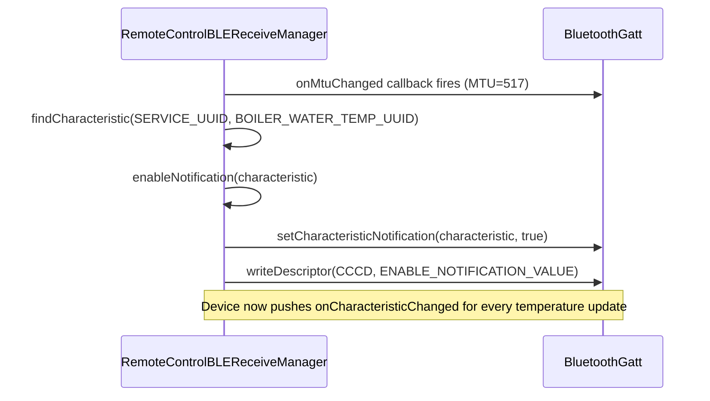

# Flow: BLE Notifications → RemoteControlScreen

> **Diagram file:** [diagram.mermaid](diagram.mermaid) — pure `flowchart LR` swimlane diagram (`.mermaid` format, no markdown wrapper).

**Trigger:** The BLE device sends a GATT Notification on the Boiler Water Temperature characteristic (`…1402`) after the app enables notifications on connect.  
**Ends:** `BoilerTemperatureProgressIndicator` recomposes with the new temperature.

---

## Mermaid Sequence Diagram

---

## Notification Enable Path (one-time on connect)

---

## Data Classes Involved

| Class | Role |
|-------|------|
| `BoilerDataResult` | Carries `waterTemperature: Float` + `connectionState` |
| `Resource<T>` | Wrapper — `Success`, `Loading`, or `Error` |
| `ConnectionState` | Enum tracked on the ViewModel (`Connected`, `Disconnected`, …) |

---

## `BoilerTemperatureProgressIndicator` — Rendering Logic

| Aspect | Detail |
|--------|--------|
| Arc sweep | `(270° / maxValue) × boilerWaterTemp` starting at 135° |
| Tick marks | 151 ticks (0–150); red above 105 °C up to target; primary colour below target; faded above |
| Centre text | `"{boilerWaterTemp}°C"` (large) + `"Target: {boilerTargetTemp}°C"` (small) |
| Target pointer | A larger tick mark drawn at `boilerTargetTemp` angle |
