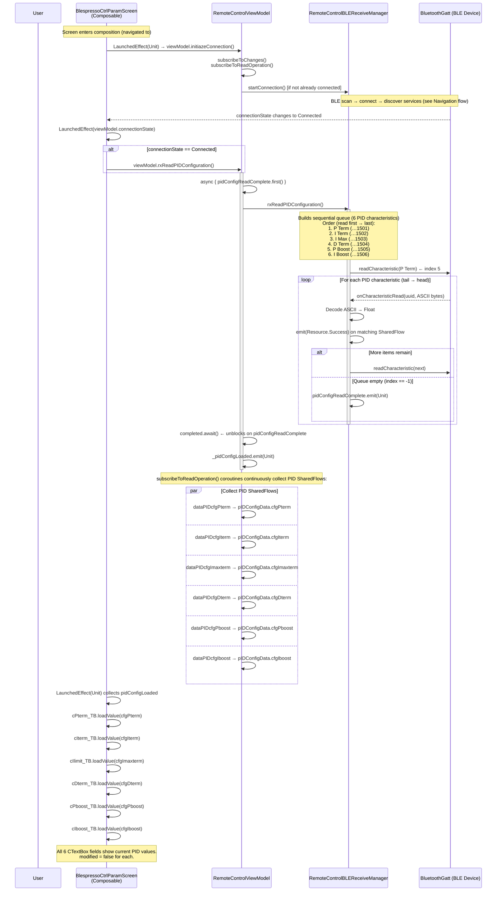
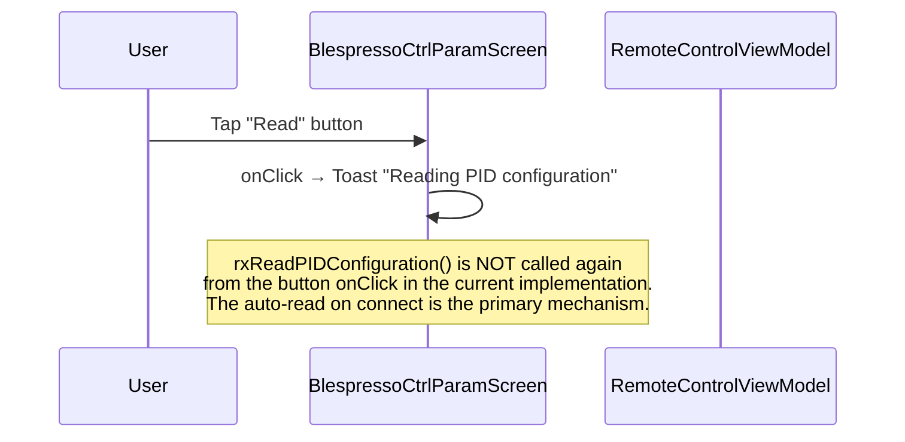

# Flow: READ Button — ControllerParameterScreen

> **Diagram file:** [diagram.mermaid](diagram.mermaid) — pure `flowchart LR` swimlane diagram (`.mermaid` format, no markdown wrapper).

**Trigger:** The screen is navigated to (composable first shown) **or** the user taps the **Read** button.  
**Ends:** All 6 PID parameter text fields are populated with values read from the BLE device.

> The READ on this screen is largely **automatic**: `LaunchedEffect(viewModel.connectionState)` calls `rxReadPIDConfiguration()` the moment the BLE connection is `Connected`.

---

## Mermaid Sequence Diagram

---

## Manual READ Button

When the user explicitly taps **Read**:

> The button currently shows a toast only. The actual PID read is initiated automatically on connection.

---

## Key SharedFlows

| SharedFlow | Carries | ViewModel state |
|------------|---------|-----------------|
| `dataPIDcfgPterm` | `CharDataClass` | `pIDConfigData.cfgPterm` |
| `dataPIDcfgIterm` | `CharDataClass` | `pIDConfigData.cfgIterm` |
| `dataPIDcfgImaxterm` | `CharDataClass` | `pIDConfigData.cfgImaxterm` |
| `dataPIDcfgDterm` | `CharDataClass` | `pIDConfigData.cfgDterm` |
| `dataPIDcfgPboost` | `CharDataClass` | `pIDConfigData.cfgPboost` |
| `dataPIDcfgIboost` | `CharDataClass` | `pIDConfigData.cfgIboost` |
| `pidConfigReadComplete` | `Unit` (signal) | triggers `_pidConfigLoaded` |
