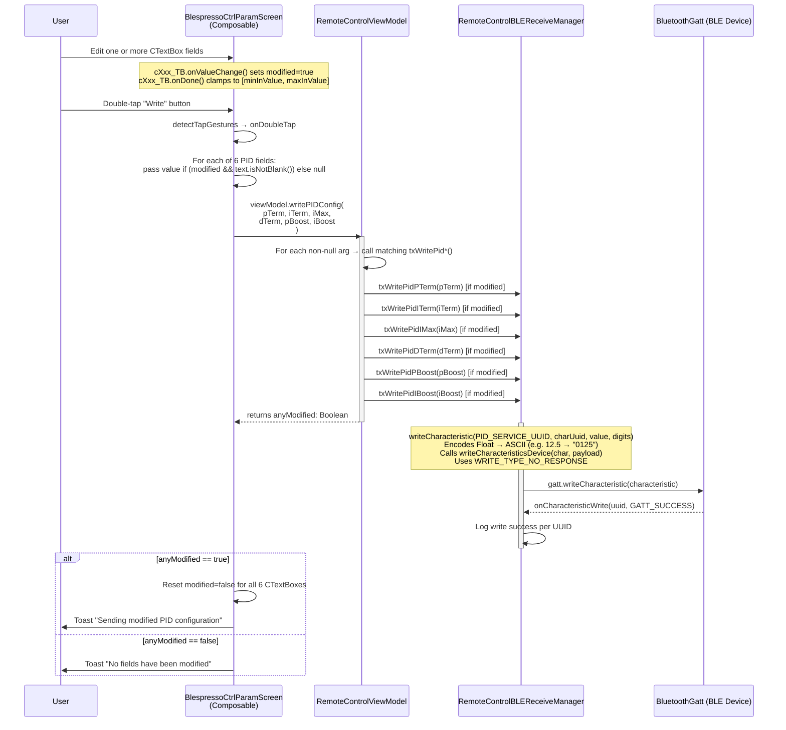

# Flow: WRITE Button — ControllerParameterScreen

> **Diagram file:** [diagram.mermaid](diagram.mermaid) — pure `flowchart LR` swimlane diagram (`.mermaid` format, no markdown wrapper).

**Trigger:** User **double-taps** the **Write** button in `BlespressoCtrlParamScreen`.  
**Ends:** Only fields that were modified since the last read are written to the BLE device via GATT.

> **Note:** Single tap shows "click" toast as confirmation feedback. Only a **double-tap** triggers the write to the device.

---

## Mermaid Sequence Diagram

---

## Value Encoding Details

| Characteristic | UUID suffix | Digits | Example |
|----------------|-------------|--------|---------|
| PID P Term     | `…1501` | 4 | `12.5 → "0125"` |
| PID I Term     | `…1502` | 3 | `1.5 → "015"` |
| PID I Max      | `…1503` | 4 | `50.0 → "0500"` |
| PID D Term     | `…1504` | 3 | `2.5 → "025"` |
| PID P Boost    | `…1505` | 3 | `1.0 → "010"` |
| PID I Boost    | `…1506` | 3 | `6.5 → "065"` |

---

## Parameter Ranges

| Field | Min | Max |
|-------|-----|-----|
| P (Proportional) | 0 | 100 |
| I (Integral) | 0 | 20 |
| I_Max (Integral limit) | 0 | 500 |
| D (Derivative) | 0 | 10 |
| P_Boost (Phase-1 P-gain boost) | 0 | 10 |
| I_Boost (Phase-1 I-gain boost) | 0 | 20 |
