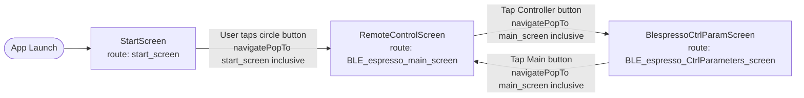
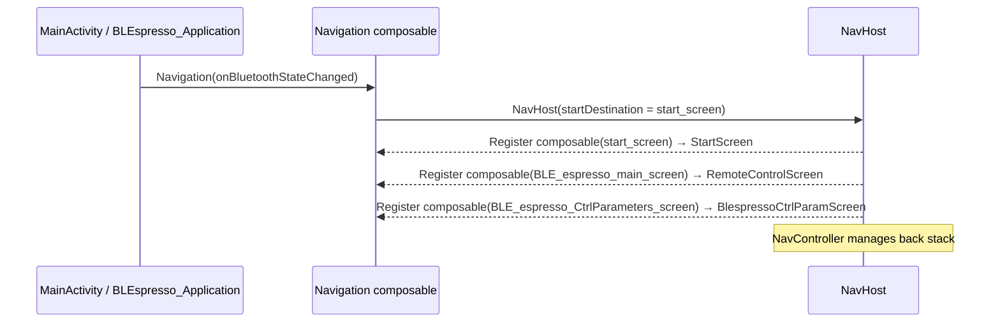
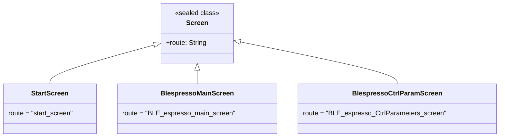

# Flow: Navigation

> **Diagram file:** [diagram.mermaid](diagram.mermaid) — pure `flowchart LR` swimlane diagram (`.mermaid` format, no markdown wrapper).

**File:** `Navigation.kt`  
**Pattern:** Jetpack Navigation Compose — `NavHost` with three destinations.

---

## Screen Route Map

---

## Navigation Composition

---

## Route Definitions

---

## Back Stack Behaviour

All navigations use `popUpTo` with `inclusive = true`, so the source screen is removed from the back
stack on each transition. The Android system back button effectively exits the app from `RemoteControlScreen`
and returns to `RemoteControlScreen` from `BlespressoCtrlParamScreen`.

| From | To | popUpTo | inclusive |
|------|----|---------|-----------|
| StartScreen | RemoteControlScreen | StartScreen | true |
| RemoteControlScreen | ControllerParamScreen | RemoteControlScreen | true |
| ControllerParamScreen | RemoteControlScreen | RemoteControlScreen | true |

---

## BLE Lifecycle vs. Navigation

| Screen | BLE action on entry |
|--------|---------------------|
| `StartScreen` | None — no BLE operations |
| `RemoteControlScreen` | `initiazeConnection()` on `Uninitialized`; `reconnect()` on `Disconnected` (via `DisposableEffect ON_START`) |
| `BlespressoCtrlParamScreen` | `initiazeConnection()` via `LaunchedEffect(Unit)`; auto-reads PID config on `Connected` |
