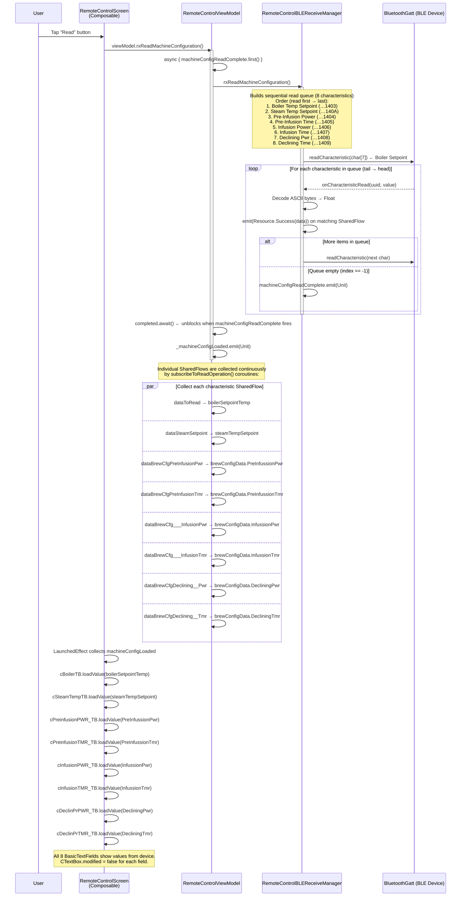
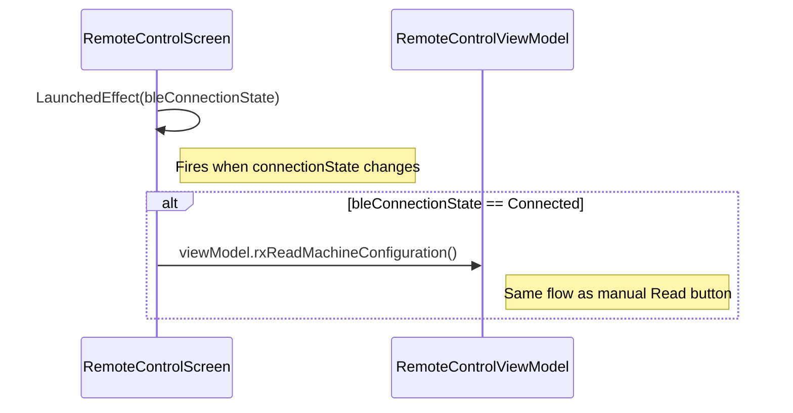

# Flow: READ Button — RemoteControlScreen

> **Diagram file:** [diagram.mermaid](diagram.mermaid) — pure `flowchart LR` swimlane diagram (`.mermaid` format, no markdown wrapper).

**Trigger:** User taps the **Read** button in the Machine Configuration section of `RemoteControlScreen`.  
**Ends:** All 8 machine-configuration text fields are populated with values read from the BLE device.

---

## Mermaid Sequence Diagram

---

## Auto-Read on Connect

`RemoteControlScreen` also triggers a read automatically when the BLE device first connects:

---

## Key Classes / SharedFlows

| SharedFlow | Carries | ViewModel state updated |
|------------|---------|------------------------|
| `dataToRead` | `BoilerSetpoint` | `boilerSetpointTemp` |
| `dataSteamSetpoint` | `BoilerSetpoint` | `steamTempSetpoint` |
| `dataBrewCfgPreInfusionPwr` | `CharDataClass` | `brewConfigData.PreInfussionPwr` |
| `dataBrewCfgPreInfusionTmr` | `CharDataClass` | `brewConfigData.PreInfussionTmr` |
| `dataBrewCfg___InfusionPwr` | `CharDataClass` | `brewConfigData.InfussionPwr` |
| `dataBrewCfg___InfusionTmr` | `CharDataClass` | `brewConfigData.InfussionTmr` |
| `dataBrewCfgDeclining__Pwr` | `CharDataClass` | `brewConfigData.DecliningPwr` |
| `dataBrewCfgDeclining__Tmr` | `CharDataClass` | `brewConfigData.DecliningTmr` |
| `machineConfigReadComplete` | `Unit` (signal) | triggers `_machineConfigLoaded` |
