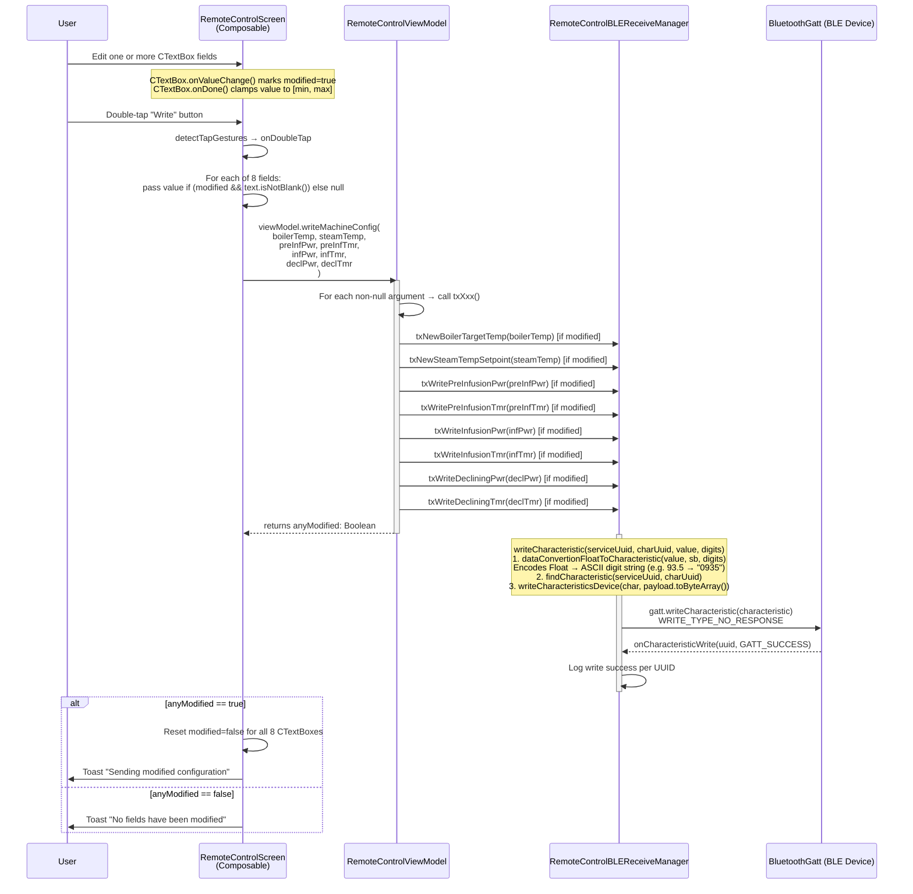
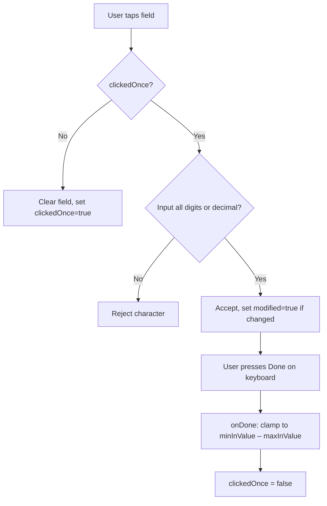

# Flow: WRITE Button — RemoteControlScreen

> **Diagram file:** [diagram.mermaid](diagram.mermaid) — pure `flowchart LR` swimlane diagram (`.mermaid` format, no markdown wrapper).

**Trigger:** User **double-taps** the **Write** button in the Machine Configuration section of `RemoteControlScreen`.  
**Ends:** Only modified fields are written to the BLE device via GATT `writeCharacteristic`.

> **Note:** A single tap shows a toast ("click") as feedback. Only a **double-tap** commits the write. This guards against accidental writes.

---

## Mermaid Sequence Diagram

---

## Value Encoding Details

| Characteristic | UUID suffix | Digits | Example |
|----------------|-------------|--------|---------|
| Boiler Temp Setpoint | `…1403` | 4 | `93.5 → "0935"` |
| Steam Temp Setpoint  | `…140A` | 4 | `140.0 → "1400"` |
| Pre-Infusion Power   | `…1404` | 3 | `35.0 → "350"` |
| Pre-Infusion Time    | `…1405` | 3 | `5.0 → "050"` |
| Infusion Power       | `…1406` | 4 | `99.0 → "0990"` |
| Infusion Time        | `…1407` | 3 | `5.0 → "050"` |
| Declining Pwr        | `…1408` | 4 | `80.0 → "0800"` |
| Declining Time       | `…1409` | 3 | `10.0 → "100"` |

---

## Input Validation (CTextBox)

