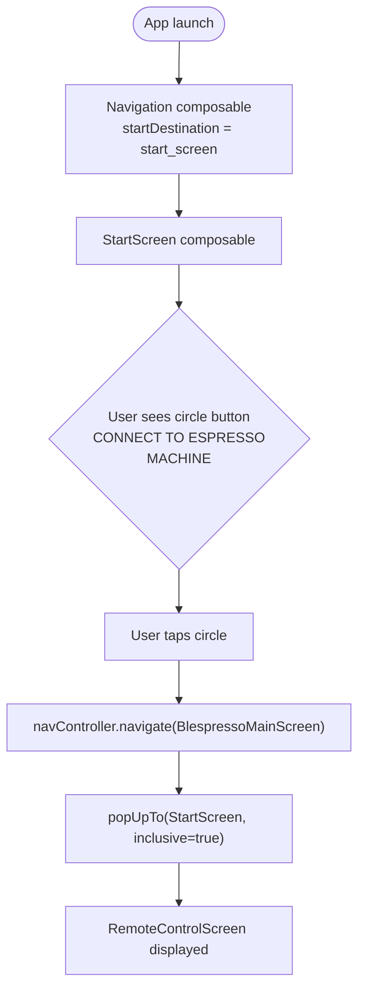
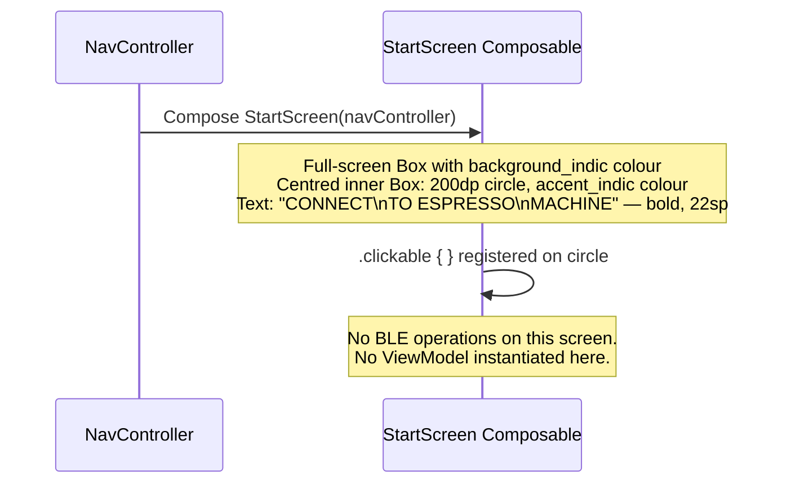

# Flow: StartScreen

> **Diagram file:** [diagram.mermaid](diagram.mermaid) — pure `flowchart LR` swimlane diagram (`.mermaid` format, no markdown wrapper).

**File:** `StartScreen.kt`  
**Purpose:** Entry point displayed when the app launches. The user taps the large circle button to initiate the BLE connection and navigate to the main control screen.

---

## User Interaction Flow



---

## Screen Composition



---

## UI Elements

| Element | Properties |
|---------|------------|
| Outer `Box` | `fillMaxSize`, `background(background_indic)`, `contentAlignment = Center` |
| Circle `Box` | `size(200.dp)`, `clip(CircleShape)`, `background(accent_indic)`, clickable |
| `Text` | "CONNECT\nTO ESPRESSO\nMACHINE", `22.sp`, bold, `textAlign = Center`, `color = textprimary_indic` |

---

## Navigation Action on Tap

```kotlin
navController.navigate(Screen.BlespressoMainScreen.route) {
    popUpTo(Screen.StartScreen.route) { inclusive = true }
}
```

`inclusive = true` removes `StartScreen` from the back stack so the back button does not return here.
