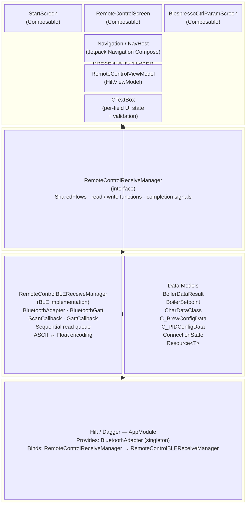
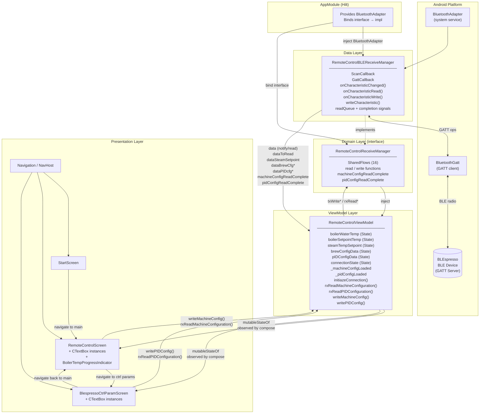

# BLEspresso System Design

> **Diagram files (pure `.mermaid`, `flowchart LR` swimlane format, no markdown wrapper):**
> - Layer View: [system_design_layer.mermaid](system_design_layer.mermaid)
> - Component View: [system_design_component.mermaid](system_design_component.mermaid)

This document describes the design of the BLEspresso Android application using two complementary views:

1. **Layer View** — shows the logical tiers of the system and what lives in each tier (MVVM + Clean Architecture).
2. **Component View** — shows the concrete classes/objects and how they wire together at runtime (chosen because it reveals the exact dependency graph that Hilt manages and how data flows through SharedFlows, which is harder to see in a pure layer diagram).

---

## 1. Layer View

The system is structured as four horizontal layers. Dependencies flow **downward only** — upper layers never import lower-layer concrete types directly; they depend only on the interface declared in the Domain layer.

### Layer Responsibilities

| Layer | Responsibility |
|-------|---------------|
| **Presentation** | Render UI (Jetpack Compose), handle user input, observe ViewModel state, manage Android lifecycle events |
| **Domain / Interface** | Declare the contract between ViewModel and BLE implementation; enables mock injection for tests |
| **Data** | BLE scan/connect/GATT operations, ASCII↔Float encoding, sequential read queuing, SharedFlow emission |
| **DI** | Wire concrete implementations to interfaces at build time via Hilt; provide platform singletons |

---

## 2. Component View

The Component View shows the concrete runtime objects, the Kotlin `SharedFlow` channels between them, and the GATT boundary with the physical device. This layout was chosen because the key architectural detail of this system is **how data pulses through reactive streams** from hardware callbacks all the way to Compose recomposition — something a flat layer diagram cannot capture.

### Component Descriptions

| Component | Type | Key Responsibility |
|-----------|------|--------------------|
| `BluetoothAdapter` | Android system | BLE scanner; provided as Hilt singleton |
| `BluetoothGatt` | Android system | GATT client; manages connection to device |
| `BLEspresso Device` | External hardware | GATT server hosting Machine Control (0x1400) and PID Controller (0x1500) services |
| `RemoteControlBLEReceiveManager` | Data class | Sole owner of BLE state; encodes/decodes ASCII↔Float; serialises reads via queue |
| `RemoteControlReceiveManager` | Interface | Dependency inversion boundary; 16 SharedFlows + function declarations |
| `RemoteControlViewModel` | HiltViewModel | Collects all SharedFlows; exposes `mutableStateOf` state for Compose; orchestrates read/write sequences |
| `CTextBox` | UI state class | Per-field state: `userInput`, `modified`, `clickedOnce`, min/max clamping |
| `StartScreen` | Composable | No BLE; pure navigation trigger |
| `RemoteControlScreen` | Composable | Live temperature indicator + machine config read/write UI |
| `BlespressoCtrlParamScreen` | Composable | PID parameter read/write UI; auto-reads on connect |
| `Navigation / NavHost` | Compose Nav | Routes: `start_screen` → `main_screen` ⇌ `ctrl_param_screen` |
| `AppModule` | Hilt module | Provides `BluetoothAdapter`; binds interface to implementation |

---

## Document Index

| Document | Path |
|----------|------|
| GATT Table | [../GATT_Table.md](../GATT_Table.md) |
| Flow Index | [flows/index.md](flows/index.md) |
| Project Requirements | [../ProjectRequirementsDocument.md](../ProjectRequirementsDocument.md) |
| Architecture Analysis | [../ArchitectureAnalysis.md](../ArchitectureAnalysis.md) |
